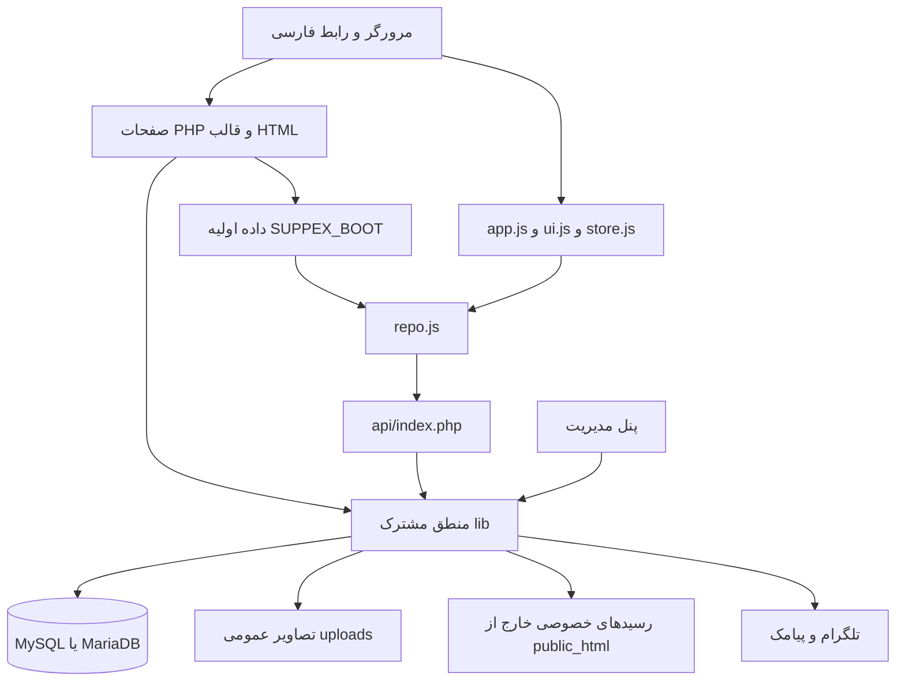

# نقشهٔ پروژه SUPPEX

این پروژه فروشگاه فارسی مکمل ورزشی با رابط RTL، پنل مدیریت و ثبت سفارش کارت‌به‌کارت است. منبع کار این پوشه است و خروجی سایت روی cPanel با PHP و MySQL/MariaDB اجرا می‌شود. انتشار کد در GitHub و انتقال فایل‌ها به هاست دو مرحلهٔ مستقل هستند.

تاریخ بررسی: ۱۴ اکتبر ۲۰۲۶. راهنمای اجرایی دستیار در `AGENTS.md` قرار دارد.

## معماری فعلی

| بخش | فایل‌ها | مسئولیت |
|---|---|---|
| صفحهٔ اصلی | `index.html` و `index.php` | قالب HTML و پرکردن شبکه‌ها، اطلاعات SEO و دادهٔ اولیه از سرور |
| صفحات فروشگاه | `product.php`، `category.php`، `brands.php`، `brand.php`، `goal.php` | محصول، دسته، برند و خرید بر اساس هدف |
| محتوا | `page.php`، `journal.php`، `article.php` و `content/` | قوانین، راهنمای دسته‌بندی و مجله، با فایل‌های Markdown |
| پیگیری مشتری | `track.php` | پیگیری با کد سفارش و موبایل، رسید و نظر خریدار |
| رابط مشترک | `partials/` | هدر، فوتر، فونت و assetهای مشترک |
| API | `api/index.php?r=...` | کاتالوگ، جستجو، تنظیمات عمومی، قیمت، سفارش و رسید |
| منطق سرور | `lib/` | دیتابیس، قیمت‌گذاری، موجودی، سفارش، ورود اطلاعات، امنیت و رسانه |
| مدیریت | `admin/` | محصولات، دسته‌ها، برندها، سفارش، موجودی، قیمت، گزارش و نگهداری |
| دیتابیس | `db/schema.sql`، `db/seed.php`، `lib/migrate.php` | نصب تازه، کاتالوگ نمونه و ارتقای دیتابیس موجود |
| SEO | `lib/seo.php`، `og.php`، `sitemap.php`، `robots.php`، `llms.php` | متادیتا، کارت اشتراک محصول و خروجی‌های قابل خواندن برای crawler |
| تست و ابزار | `tests/` و `tools/` | تست‌های PHP/Node، ساخت CSS، تشخیص هاست و کرون نرخ ارز |

پروژه package manager یا framework ندارد؛ `package.json` و `composer.json` وجود ندارند. یک ساخت سبک CSS با خود PHP انجام می‌شود. فونت‌ها و نسخهٔ Three.js داخل `assets/` هستند؛ توضیح قدیمی README دربارهٔ نیاز به CDN وضعیت فعلی را توصیف نمی‌کند.



## جریان رابط کاربری

- `assets/js/config.js`: برند، مسیر API و محصول، نمایش تومان، کانال‌های سفارش و فلگ‌ها. مقدار فعلی API برابر `api/index.php` است؛ بازکردن صرف `index.html` با دابل‌کلیک معادل اجرای نسخهٔ کامل نیست.
- `catalog.js`: کاتالوگ نمونه برای حالت استاتیک؛ منبع محصولات واقعی نسخهٔ کامل دیتابیس است.
- `repo.js`: واسط Promise بین UI و داده. ابتدا دادهٔ آمادهٔ `SUPPEX_BOOT` را می‌خواند و درخواست‌های هم‌زمان مشابه را یکی می‌کند؛ سپس برای دادهٔ دیگر سراغ API می‌رود.
- `store.js`: سبد در `localStorage`، تفکیک اندازه/طعم/ویژگی، همگام‌سازی قیمت و مدیریت اطلاعات سفارش در مرورگر.
- `ui.js`: رندر مشترک کارت‌ها، سبد، پنل پرداخت و اجزای رابط.
- `app.js`: کنترلرها، جستجو، فیلتر، گالری، خرید، ارسال رسید، شمارش زمان و وضعیت سفارش‌های مرورگر.
- `hero3d.js`، `hero-labels.js` و `assets/models/`: قابلیت و مدل سه‌بعدی موجود در کد؛ صفحهٔ اصلی فعلی همچنین اسلایدر پیشنهادها را از محصولات واقعی می‌سازد.

`index.php` بخش‌هایی از `index.html` را با marker دقیق جایگزین می‌کند. تغییر قالب باید با مسیر PHP بررسی شود. اطلاعات عمومی صفحه و پاسخ API برای دادهٔ مشابه باید همخوان بمانند.

رنگ‌ها و فونت‌ها در `tokens.css` هستند؛ CSS به ترتیب `tokens`، `base`، `components`، `layout` به `site.css` تبدیل می‌شود. بعد از تغییر هر منبع باید `tools/build-css.php` اجرا و bundle هم داخل ZIP گذاشته شود. `asset()` نسخهٔ URL را از زمان فایل می‌سازد تا فایل جدید در کش قبلی گیر نکند.

## منطق فروشگاه

| حوزه | فایل اصلی | رفتار مهم |
|---|---|---|
| محصول و جستجو | `lib/products.php` | تبدیل دادهٔ دیتابیس به قرارداد frontend، موجودی قابل فروش، مشخصات و جستجوی فارسی |
| انتخاب‌ها | `lib/variants.php` | ویژگی‌ها و ترکیب اندازه/طعم/گزینه‌ها، قیمت و موجودی ترکیب |
| قیمت | `lib/pricing.php` | خرید درهمی یا تومانی، سود ثابت/درصدی، تخفیف، گردکردن و کنترل قیمت |
| نرخ ارز | `lib/rate.php` | خواندن TGJU و Alanchand، بررسی تازگی و توافق منابع، هموارسازی و اعمال کنترل‌شده |
| قیمت وعده‌داده‌شده | `lib/quotes.php` | توکن قیمت با اعتبار محدود؛ مقدار پیش‌فرض quote دو ساعت است |
| سفارش | `lib/orders.php` | اعتبارسنجی، محاسبهٔ سرور، تشخیص تکرار، ثبت تراکنشی و تاریخچه |
| انبار | `lib/stock.php` | رزرو هم‌زمان امن و بازگرداندن موجودی در لغو/انقضا |
| رسید | `lib/receipts.php` | بررسی/بازرمزگذاری تصویر، نگهداری خصوصی، سقف و throttle، اطلاع‌رسانی |
| نظر خریدار | `lib/reviews.php` | نظر مرتبط با سفارش و انتشار پس از بررسی مدیر |
| پیام سفارش | `lib/order_messages.php` و `lib/notify.php` | متن یکسان برند، لینک پیگیری، تلگرام و پیامک |
| ورود گروهی | `lib/import.php`، `lib/import_sheet.php`، `lib/xlsx.php` | CSV/XLSX، الگو/خروجی، تطبیق تصاویر و اطلاعات محصولات |
| پشتیبان و آمادگی | `lib/backup.php` و `lib/preflight.php` | خروجی SQL/کاتالوگ و بررسی پیش‌نیازها |

قیمت و تعداد سبد مرورگر ورودی قابل اعتماد نیستند. سرور قیمت را دوباره تعیین می‌کند؛ قیمت معتبر quote را فقط از دادهٔ ذخیره‌شدهٔ خودش می‌خواند. بازهٔ نگهداری سفارش مستقل از اعتبار quote است و از تنظیمات فروشگاه می‌آید. وضعیت‌ها `new`، `paid`، `shipped`، `done`، `cancelled` و `expired` هستند.

سود و سهم همکاری روی سفارش و ردیف‌های آن snapshot می‌شوند. تغییر نرخ یا درصد امروز نباید گزارش مالی سفارش‌های گذشته را عوض کند. موجودی `NULL` یعنی شمرده‌نشده؛ صفر با آن فرق دارد. رسید آپلودی خودبه‌خود سفارش را پرداخت‌شده نمی‌کند.

## API و پنل

مسیرهای خواندن: `products`، `product`، `categories`، `brands`، `search`، `config` و `prices`. مسیرهای POST: `order`، `orderstate`، `myorders` و `receipt`. شمارهٔ کارت همراه پاسخ سفارش می‌آید و در تنظیمات عمومی منتشر نمی‌شود. API با `?r=` کار می‌کند و برای انتخاب endpoint به rewrite وابسته نیست.

پنل دارای داشبورد، فهرست/ویرایش محصولات، ورود اکسل، دسته‌ها، برندها، تصاویر، موجودی، قیمت‌گذاری، سود، سفارش/چاپ سفارش، رسید، نظرات، گزارش و تنظیمات است. نقش `support` قابلیت `maintenance` دارد؛ نقش `manager` مدیریت عادی فروشگاه را انجام می‌دهد. پشتیبان، ارتقای schema، آمادگی راه‌اندازی و کاربران محدود به قابلیت نگهداری هستند. مقدار قدیمی `owner` برای گذار ارتقا پشتیبانی می‌شود.

## دیتابیس و فایل‌های خصوصی

دسترسی با PDO، prepared statement واقعی، `utf8mb4` و InnoDB انجام می‌شود. ساعت PHP تهران و ساعت اتصال دیتابیس `+03:30` است. config از متغیر محیطی `SUPPEX_CONFIG`، سپس مسیر بالای پروژه و در آخر نسخهٔ داخل پروژه پیدا می‌شود.

schema پایه ۱۶ جدول دارد: مدیران و تلاش ورود؛ دسته/محصول/تصویر/طعم/اندازه؛ سفارش/ردیف/رویداد؛ تنظیمات و ثبت سهم؛ رسید، برند، نظر و تصاویر منتظر ورود. migrationها جدول‌های quote، تاریخچه/خوانش نرخ و ویژگی/ترکیب محصول را هم اضافه می‌کنند. اجرای صرف `schema.sql` وضعیت کامل نسخهٔ فعلی را ایجاد نمی‌کند.

روی هاست:

```text
/home/ACCOUNT/
├── suppex-config.php          تنظیمات واقعی و رمزها
├── suppex-private/receipts/   رسیدهای خصوصی
├── rate-cron.php              در صورت فعال‌بودن قیمت خودکار
└── public_html/               فایل‌های سایت
    ├── admin/ api/ lib/ partials/ content/ assets/ db/
    └── uploads/               تصاویر عمومی و کش قابل بازتولید
```

`uploads/products` دادهٔ اجرایی است و باید جدا از کد پشتیبان داشته باشد. `uploads/og` کش است. پشتیبان کامل شامل SQL، رسانهٔ عمومی، رسیدهای خصوصی و تنظیمات خصوصی در محل امن است.

## اجرای محلی و تست‌ها

PHP در PATH نیست، ولی runtime قبلی موجود است:

```powershell
& 'C:\Users\Asus\Desktop\SUPPEX-local\php\php.exe' -v
& 'C:\Users\Asus\Desktop\SUPPEX-local\php\php.exe' tools\build-css.php
$env:SUPPEX_DB_PORT = '3399' # فقط پورت دیتابیس محلیِ مخصوص تست
& 'C:\Users\Asus\Desktop\SUPPEX-local\php\php.exe' tests\run.php
```

MariaDB و router محلی در پوشهٔ همسایهٔ `SUPPEX-local` هستند. `.claude/launch.json` مسیرهای قبلی پیش‌نمایش را دارد؛ یکی از آن‌ها به scratchpad موقت Claude اشاره می‌کند و مسیر دائمی توسعه نیست. وب‌سرور داخلی PHP فایل `.htaccess` را اجرا نمی‌کند.

تست‌ها `suppex_test` و `suppex_fresh` را پاک و دوباره پر می‌کنند. روی این دستگاه در بررسی اولیه یک instance مستقل MariaDB روی loopback و پورت 18437 ساخته شد؛ دیتابیس اصلی و cPanel برای تست استفاده نشدند. برای instance تازه ابتدا schema پایه و seed لازم است و سپس runner migrationها را اجرا می‌کند.

نتیجهٔ بررسی اولیه:

| بررسی | نتیجه |
|---|---|
| syntax PHP، بدون فایل config خصوصی | ۱۳۲ فایل، صفر خطا |
| syntax JavaScript و تست‌های Node | ۲۰ فایل، صفر خطا |
| تازگی bundle CSS | مطابق منابع |
| مجموعهٔ کامل موجود، ۲۸ suite PHP و ۱۱ suite Node | ۳۴۵۳ بررسی موفق، صفر خطا |
| درخواست محلی به API محصولات و ۱۳ مسیر فروشگاه، محتوا، SEO و ورود پنل | پاسخ موفق، بدون خطای PHP |

گزارش قدیمی `tests/tmp/last-run.txt` فقط ۷۰۶ بررسی دارد و نتیجهٔ این بررسی جدید نیست. runner فعلی exit code فرایند Node را بررسی نمی‌کند؛ در اجرای اولیه هر ۱۱ suite خروجی و شمارش موفق داشتند.

## وضعیت نسخه‌ها هنگام تحویل

پیش از این بررسی، `UI Workout` پوشهٔ `.git` نداشت. مخزن جداگانهٔ `Desktop/suppex-demo` روی `22b90d0` بود و ۲۲ کامیت جلوتر از نسخهٔ GitHub روی `a9ed2d8` قرار داشت. نسخهٔ فعلی `UI Workout` نسبت به آن مخزن محلی نیز ۸۸ فایل tracked متفاوت و فایل‌های اجرایی جدید داشت؛ هیچ فایل tracked آن مخزن در این پوشه مفقود نبود. مقایسهٔ فایل‌های متنی با یکسان‌کردن CRLF/LF انجام شد.

اتصال گیت این پوشه باید تاریخچهٔ همان ۲۲ کامیت را حفظ کند و نسخهٔ فعلی را از همین پوشه بگیرد. پوشهٔ همسایه نسخهٔ قدیمی‌تر است و نباید مبنای ویرایش بعدی قرار بگیرد. GitHub مخزن عمومی است. CSV و XLSX تجاری در تاریخچهٔ قبلی آن وجود دارند؛ حذف از نسخهٔ فعلی تاریخچه را پاک نمی‌کند. بررسی قیمت‌های آن داده و تصمیم دربارهٔ پاکسازی تاریخچه/خصوصی‌کردن مخزن یک اقدام مستقل است.

در پوشه ۱۲ آرشیو قدیمی وجود داشت؛ ZIPهای `suppex-update-*` بسته‌های افزایشی‌اند و چند بسته فقط یک فایل دارند. هیچ‌کدام را معادل نسخهٔ کامل امروز فرض نکنید. عکس‌های عمومی، فایل‌های ورود محصول، صفحه‌های ذخیره‌شدهٔ مرورگر و طرح‌های لوگو هم در پوشه‌اند و با کد اجرایی فرق دارند.

## انتقال تغییرات به cPanel

برای تغییر معمول، یک ZIP افزایشی با فایل‌های تغییرکرده و وابستگی‌های لازم بسازید. ریشهٔ آن باید مستقیم شامل مسیرهای سایت باشد؛ استخراج در `public_html` انجام می‌شود. این ZIP جایگزین دیتابیس و رسانه‌های موجود نیست.

1. تغییر را در همین پوشه انجام دهید، تست مرتبط را اجرا کنید و در صورت تغییر CSS bundle را بسازید.
2. فایل‌های مربوط را commit و به `GlimaCode/suppex-demo` push کنید.
3. ZIP را بدون config، spreadsheet، تست، ابزار، فایل‌های گیت، منابع پژوهش محصول و کش بسازید؛ `.htaccess` لازم را حفظ کنید.
4. فهرست اعضای ZIP را بررسی کنید و پوشهٔ مقصد و فایل‌های اضافه/حذف‌شونده را در راهنمای همراه مشخص کنید. استخراج ZIP فایل قدیمی را حذف نمی‌کند؛ حذف لازم باید صریح گفته شود.
5. برای تغییر schema، قبل از ارتقا از دیتابیس پشتیبان بگیرید و بعد از استخراج `admin/migrate.php` را با نقش مجاز اجرا کنید. برای فروشگاه موجود `setup.php` اجرا نمی‌شود.
6. کرون قیمت‌گذاری، در صورت تغییر، جداگانه بیرون `public_html` قرار می‌گیرد. وجود فایل کرون محلی به معنی فعال‌بودن آن روی cPanel نیست.
7. صفحهٔ آمادگی، صفحه‌های تغییرکرده و مسیر سفارش را روی هاست بررسی کنید.

برای نصب کامل، علاوه بر پوشه‌های اجرایی، فایل‌های فعلی `index.php`، `index.html`، `product.php`، `product.html`، `category.php`، `brands.php`، `brand.php`، `goal.php`، `page.php`، `journal.php`، `article.php`، `track.php`، `og.php`، `robots.php`، `robots.txt`، `sitemap.php`، `llms.php`، `404.html` و `.htaccess` لازم‌اند؛ فایل‌های تأیید مالکیت Google/Bing نیز در صورت نیاز دامنه همراه سایت هستند. `setup.php` فقط برای نصب تازه است و سپس حذف می‌شود. `admin-reset.php` ابزار بازیابی موقت است و به بستهٔ عادی سایت تعلق ندارد.

## موارد باقی‌مانده برای اصلاح مستندات و نگهداری

- بخش «فاز بعدی Backend» و چند محدودیت پایان README قدیمی‌اند؛ سفارش، پنل، محتوا و سایر امکانات ذکرشده اکنون پیاده شده‌اند. طراحی فعلی اعداد فارسی دارد.
- فهرست قدیمی DEPLOY چند entry point فعلی را ندارد و حجم نوشته‌شده برای نسخهٔ قدیمی است. فایل‌های لازم فعلی و قواعد به‌روزرسانی در این نقشه و ابتدای DEPLOY ثبت شده‌اند.
- `admin/migrate.php` ورود و نقش را بررسی می‌کند، ولی handler POST آن در نسخهٔ بررسی‌شده `csrf_check()` و فرم آن `csrf_field()` ندارد. این مورد در یک تغییر امنیتی مستقل باید اصلاح و تست شود.
- runner تست Node باید exit code و اجراشدن assertionها را هم بررسی کند؛ خروجی بدون شمارش نباید موفق گزارش شود.
- وضعیت واقعی دیتابیس، کرون، نسخهٔ PHP و فایل‌های نصب روی cPanel از بررسی پوشهٔ محلی قابل تأیید نیست؛ هنگام تغییر وابسته به هاست باید بررسی شوند.
